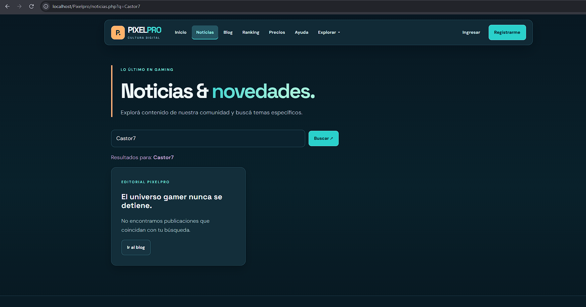
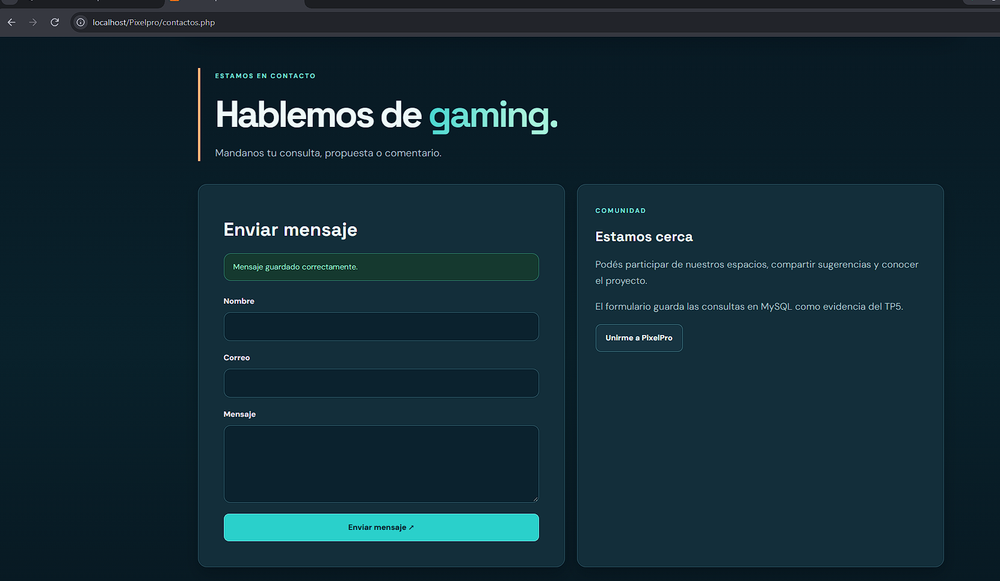

# PixelPro — TP5
}

**Instalación previa:** colocar `PixelPro/` en `C:\xampp\htdocs\`, encender Apache y MySQL, importar `PixelPro/database/schema.sql` en phpMyAdmin y configurar `PixelPro/config/.env` a partir de `.env.example` sin compartir las credenciales. Abrir `http://localhost/PixelPro/`.

## Objetivo

Procesar formularios con los métodos GET y POST, validar los datos y registrar información.

## Implementación

- `noticias.php`: búsqueda por el parámetro GET `q`; se utiliza una consulta preparada con `LIKE`.
- `contactos.php`: formulario POST con nombre, correo y mensaje, validaciones y token CSRF.
- Tabla `mensajes_contacto`: almacena los mensajes enviados desde el formulario.
- `htmlspecialchars` (a través de `e()`): protege la salida de texto.

# PixelPro — TP5

**Proyecto:** Portal gamer PixelPro · Integrador de Programación Web TP4–TP8.

**Instalación previa:** colocar `PixelPro/` en `C:\xampp\htdocs\`, encender Apache y MySQL, importar `PixelPro/database/schema.sql` en phpMyAdmin y configurar `PixelPro/config/.env` a partir de `.env.example` sin compartir las credenciales. Abrir `http://localhost/PixelPro/`.

## Objetivo

Procesar formularios con los métodos GET y POST, validar los datos y registrar información.

## Implementación

- `noticias.php`: búsqueda por el parámetro GET `q`; se utiliza una consulta preparada con `LIKE`.
- `contactos.php`: formulario POST con nombre, correo y mensaje, validaciones y token CSRF.
- Tabla `mensajes_contacto`: almacena los mensajes enviados desde el formulario.
- `htmlspecialchars` (a través de `e()`): protege la salida de texto.

## Cómo demostrarlo

1. Abrí `http://localhost/PixelPro/noticias.php`. Escribí un término en «Buscar» y presioná el botón: en la URL aparecerá `?q=...`.
2. Entrá a `http://localhost/PixelPro/contactos.php`, completá el formulario con datos de prueba y presioná «Enviar mensaje».
3. Cuando aparezca «Mensaje guardado correctamente», abrí phpMyAdmin → `pixelpro_db` → `mensajes_contacto` → **Examinar**.
4. Si la búsqueda no encuentra noticias, eso también puede mostrarse; las publicaciones dependen de los datos que tenga MySQL.

## Evidencias fotográficas (capturas reales)

### Búsqueda con GET

### Formulario con POST

### Datos registrados en MySQL

